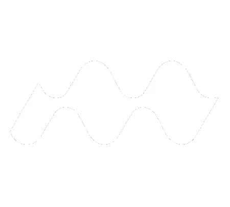
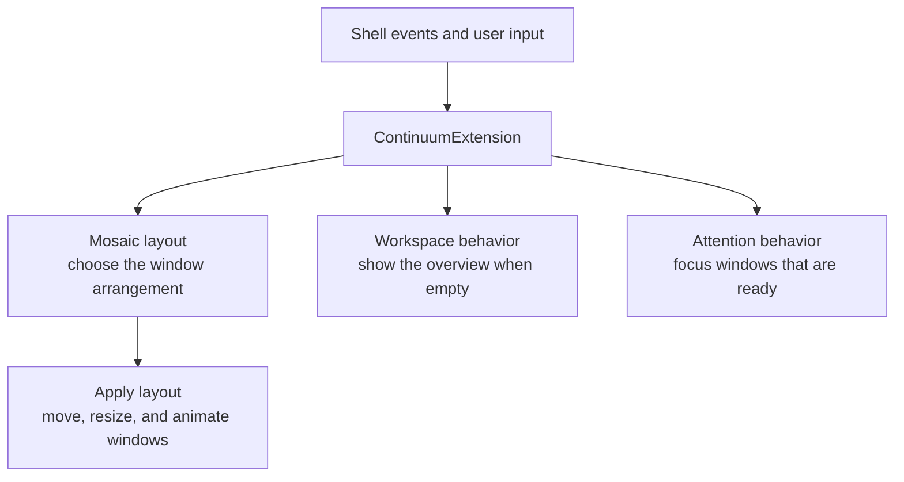

<h1> Continuum</h1>

A seamless GNOME experience with automatic window arrangement and proactive workspace management for an uninterrupted workflow.

Continuum keeps your GNOME desktop organized without manual window shuffling.
It arranges open windows into a space-filling mosaic, opens the Overview when a
workspace becomes empty, and brings apps to the front when they need your
attention instead of showing a "Window is ready" notification.

It brings together the window-management behavior of
[Mosaic WM](https://github.com/CleoMenezesJr/MosaicWM) and the empty-workspace
behavior of
[Foresight Reborn](https://github.com/gabrielpalassi/ForesightReborn), with
window-attention behavior inspired by
[NoAnnoyance v2](https://github.com/bdaase/noannoyance).

> [!WARNING]
> Continuum is a personal, experimental project and is not intended for official
> publication. It changes window placement, overrides some GNOME keybindings and
> Shell internals, and may be unstable. Build and run it at your own risk.

## Requirements

- GNOME Shell 50
- `gnome-extensions` for packaging and local installation
- Node.js and npm for the development checks

## Installing

Continuum is not published to the GNOME Extensions website. Clone the repository,
then build and install it locally:

```bash
git clone https://github.com/gabrielpalassi/Continuum.git
cd Continuum
npm run all
```

Reload GNOME Shell after installation. On Wayland, log out and back in, then
enable the extension:

```bash
gnome-extensions enable continuum@gabrielpalassi.github.io
```

## Development

Install the formatting and linting tools from the lockfile:

```bash
npm ci
```

### Checks

Run the same formatting and linting checks expected before committing:

```bash
npm run fmt-lint
```

Use `npm run fmt-lint:fix` to apply automatic fixes. The individual commands
`npm run fmt`, `npm run fmt:fix`, `npm run lint`, and `npm run lint:fix` are also
available.

### Build workflow

Package `src/` into
`dist/continuum@gabrielpalassi.github.io.shell-extension.zip`:

```bash
npm run build
```

For the usual edit-build-install cycle, run:

```bash
npm run all
```

This uninstalls any currently installed copy of Continuum, rebuilds it, and
installs the new archive. GNOME Shell must then reload the extension code as
described in [Installing](#installing).

Useful commands while testing:

| Command                      | Purpose                                        |
| ---------------------------- | ---------------------------------------------- |
| `npm start`                  | Start a nested Shell with one virtual monitor  |
| `npm run start:multimonitor` | Start a nested Shell with two virtual monitors |
| `npm run remove`             | Uninstall the local Continuum extension        |

Nested sessions are useful for quick interaction checks, but final testing
should also be done in a real Wayland session because Continuum integrates with
window placement, workspace switching, drag operations, and Shell animations.

## Architecture

Continuum is a GNOME Shell 50 extension written as GJS ES modules. Its runtime
entry point and composition root is `src/extension.js`.

### Runtime structure

| Area                | Main modules                                                       | Responsibility                                                                                                |
| ------------------- | ------------------------------------------------------------------ | ------------------------------------------------------------------------------------------------------------- |
| Extension lifecycle | `extension.js`, `settingsOverrider.js`, `timing.js`, `liveness.js` | Own shared services, Shell integration, temporary settings changes, and asynchronous cleanup.                 |
| Window lifecycle    | `windowHandler.js`, `windowing.js`, `windowState.js`               | Classify windows, track per-window state, queue placement, and handle creation, removal, and monitor changes. |
| Mosaic layout       | `tiling.js`, `reordering.js`, `swapping.js`, `edgeTiling.js`       | Compute layouts, keep windows fitted, reorder or swap tiles, and manage edge-tile zones.                      |
| User interaction    | `dragHandler.js`, `resizeHandler.js`, `grabOps.js`, `drawing.js`   | Coordinate move/resize grabs, previews, smart resizing, and visual guides.                                    |
| Visual behavior     | `animations.js`, `miniature.js`, `overviewLayout.js`               | Animate placement, represent overflow windows as miniatures, and preserve the mosaic in the overview.         |
| Workspace behavior  | `workspaceOverview.js`                                             | Show the overview when the active workspace becomes empty and hide only an overview it opened.                |
| Attention behavior  | `windowAttention.js`                                               | Replace "Window is ready" notifications with direct activation for attention-seeking windows.                 |

### Runtime flow



- **Route:** `ContinuumExtension` sends window events to mosaic and workspace
  behavior, and user actions to the interaction handlers.
- **Arrange:** Creation, removal, drag, resize, and keyboard changes share one
  tiling pipeline that chooses the target layout.
- **Apply:** Windowing and visual managers update geometry, guides, miniatures,
  and animations.

### GNOME Shell integration

| Integration point       | What Continuum owns                                                                                 | Teardown                                   |
| ----------------------- | --------------------------------------------------------------------------------------------------- | ------------------------------------------ |
| Signals and keybindings | Window, workspace, grab, resize, monitor, focus, urgency, and overview events                       | Disconnect handlers                        |
| Deferred work           | Shared timeout registry                                                                             | Cancel pending callbacks                   |
| Shell method overrides  | Workspace animation, window preview, overview layout, and screenshot behavior for miniature windows | Restore original methods                   |
| Runtime settings        | Mutter edge tiling and conflicting stock keybindings                                                | Restore through `SettingsOverrider`        |
| Window attention        | Shell's native "Window is ready" handler                                                            | Reconnect through `WindowAttentionManager` |

`enable()` constructs and connects these resources; `disable()` releases them
in reverse. Shell method overrides are the main compatibility hotspots when
updating the supported GNOME Shell version.

## Changes from upstream

Continuum integrates code from multiple extensions rather than tracking any one
of them as a drop-in fork. The most significant differences are listed below.

### Mosaic WM

Compared with [Mosaic WM](https://github.com/CleoMenezesJr/MosaicWM), Continuum:

- Places windows across all monitors in a workspace before overflowing the
  workspace.
- Prefers an empty monitor when opening a maximized or fullscreen window.
- Opens windows on their destination monitor first, using a GNOME-style entrance
  animation.
- Reorganizes the remaining windows across monitors after a window closes.
- Restores miniatures automatically when enough space becomes available.
- Keeps the current workspace active after its last window closes.
- Performs one coordinated layout on close instead of re-tiling before moving
  windows between monitors.
- Preserves window order, grouping, and previous positions where possible during
  tiling.
- Expands restored miniatures in their previous logical position.
- Fixes miniature icon animation in the Overview.
- Optimizes window caching, fit simulations, permutation generation, and
  logging.
- Removes obsolete workspace-navigation, edge-tiling, geometry, and tiling code.

### Foresight Reborn

Compared with
[Foresight Reborn](https://github.com/gabrielpalassi/ForesightReborn), Continuum:

- Integrates automatic empty-workspace overview behavior directly with mosaic
  window management.
- Coordinates window opening and closing with layout changes to avoid conflicting
  reactions.
- Preserves Foresight Reborn's temporary-window handling and never closes an
  overview opened manually by the user.

### NoAnnoyance v2

Compared with [NoAnnoyance v2](https://github.com/bdaase/noannoyance), Continuum:

- Updates immediate focus behavior for GNOME Shell 50.
- Integrates attention handling directly into Continuum and restores GNOME's
  native "Window is ready" behavior when Continuum is disabled.
- Removes the preferences and application ignore list; all eligible windows that
  demand attention are focused automatically.

## Credits and licensing

Continuum incorporates and adapts source code from:

- [Foresight Reborn](https://github.com/gabrielpalassi/ForesightReborn) by
  Gabriel Palassi, itself based on
  [Foresight](https://github.com/pesader/gnome-shell-extension-foresight) by
  pesader and Show Application View When Workspace Empty by fawtytoo.
- [Mosaic WM](https://github.com/CleoMenezesJr/MosaicWM) by Cléo Menezes Jr. and
  its contributors. Mosaic WM credits
  [window-mosaic-mode](https://gitlab.gnome.org/heikkiket/window-mosaic-mode) by
  heikkiket for the original concept and implementation.
- [NoAnnoyance v2](https://github.com/bdaase/noannoyance) by Björn Daase, a fork of
  [No Annoyance](https://github.com/sindex/no-annoyance) by Alex.

Continuum is distributed under the GNU Affero General Public License v3.0.
